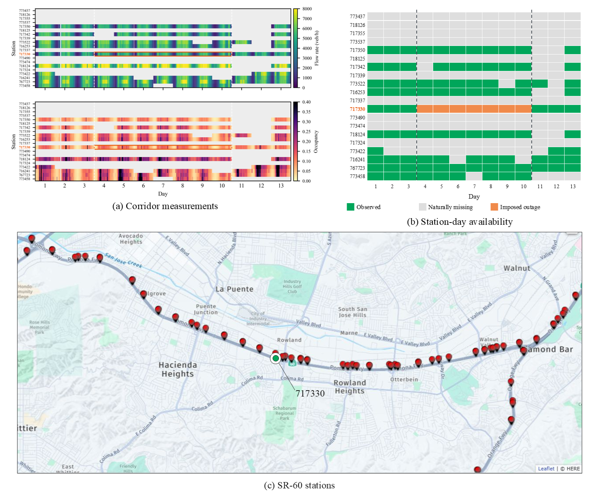
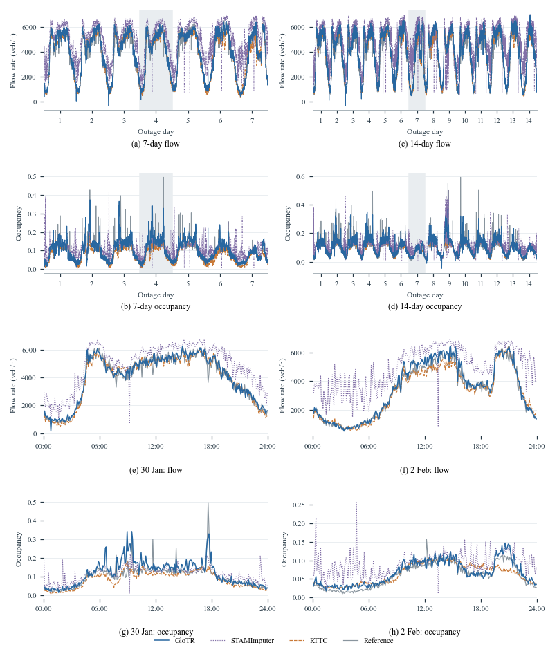
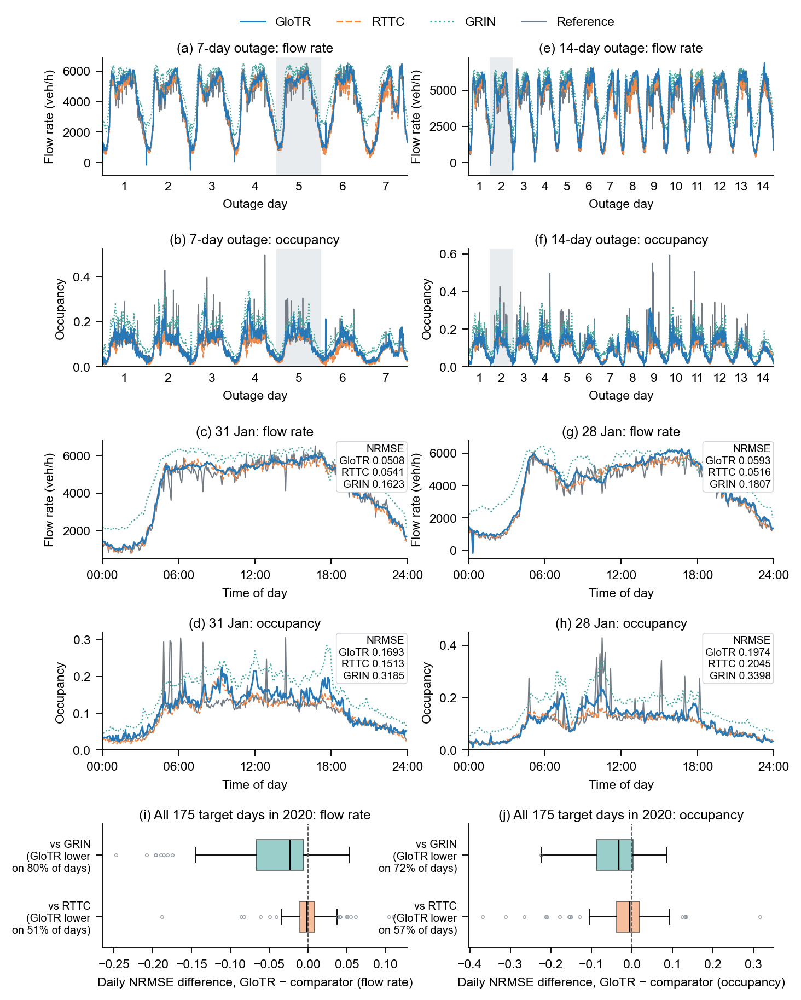

# GloTR: Global-Token Reconstruction with Residual Transfer

[](img/framework.png)

Reference implementation of **GloTR**, for the paper *"GloTR: Traffic Data
Imputation for Prolonged Sensor Outages"* (target: *Transportation Research
Part C*).

A detector that is offline for a full week leaves no observation at all: the
daily flow-rate (`q`) and occupancy (`o`) profiles of that station cannot be
computed. GloTR rebuilds them in three layers.

1. **Frozen reference profile.** A graph-conditioned basis plus a mean function,
   both frozen, give the profile this station *usually* has on that calendar day.
2. **Same-day spatial branch.** Every time slot of the target attends to the
   complete-day sequences of the other stations and to the target's own pre- and
   post-outage buffer days, and adds a correction `δ` to the frozen prediction.
3. **Error-field transfer.** At inference time the prediction errors of the
   stations that are still online form a low-rank error field, which is
   transferred to the offline station with separate loadings for q and o. No
   training is involved.

## Results

Nine methods, same episode cohorts (PeMS D7: 21 episodes in 2019, 19 in 2020),
sensor-macro NRMSE:

| Window | q | Best baseline (q) | o | Best baseline (o) |
|---|---|---|---|---|
| 2019 | 0.0457 | 0.0452 STAMImputer | **0.1148** | 0.1214 STAMImputer |
| 2020 | **0.0815** | 0.0872 modified RTTC | **0.1687** | 0.1999 modified RTTC |

GloTR is first in 5 of 8 NRMSE/MAE comparisons and second in the other 3. In
2020 it leads on all four metrics (q −6.5%, o −15.6% against the strongest
baseline); in 2019 a single-day spatiotemporal model still wins q by 1.1%.





## Setup

```bash
python -m venv .venv && .venv/Scripts/activate    # or source .venv/bin/activate
pip install -e .
gzip -dk data/pems/releases/partition_v1/station_versions.json.gz
```

The third line expands the one file that is shipped compressed (56.6 MB → 4.8 MB).
It must be a real file, not a stream: `training/qo_attributes.py` hashes it.

A CUDA device is required. The pipeline pins cuBLAS, enables deterministic
algorithms and refuses to run on CPU by design.

## Data

The corpus is **PeMS District 7** (Caltrans Performance Measurement System),
reduced to one mainline corridor: SR-60 W, 20 stations, 38 directed edges,
288 slots per day, fixed UTC−8.

### Raw source

The raw detector archives are public and are **not** distributed here. They are
archived per day and per district, so the 2019 and 2020 files are still
retrievable unchanged:

| Product | Link |
|---|---|
| PeMS Clearinghouse (index) | https://pems.dot.ca.gov/?dnode=Clearinghouse |
| Station Raw, 30 s, District 7 | https://pems.dot.ca.gov/?dnode=Clearinghouse&type=station_raw&district_id=7&submit=Submit |
| Station 5-Minute, District 7 | https://pems.dot.ca.gov/?dnode=Clearinghouse&type=station_5min&district_id=7&submit=Submit |

A free PeMS account is required. Note that **Station 5-Minute is already imputed
by PeMS** — its per-lane `Observed` flag separates measured from filled values,
so a non-empty cell is not an observation. Station Raw is the un-imputed product
but contains structurally empty records. Both facts drive the mask construction
and are documented in the project's acquisition notes.

### What is bundled

| Path | Size | Content |
|---|---|---|
| `data/pems/releases/arrays_2019/` | 43 MB | 365 daily arrays, 2019, 20 stations each |
| `data/pems/releases/arrays_2020/` | 4.5 MB | 50 daily arrays, 2020-01-01 … 2020-02-19 |
| `data/pems/releases/partition_v1/` | 8 MB | station-version attribute manifest |
| `data/pems/graphs/` | 0.4 MB | corridor topology, edge list, station attributes |
| `reviews/` | 8 MB | episode roster, mask policy, split, frozen checkpoints |

### The array crop

The published arrays are a **corridor crop** of the district release. Every
station-indexed array keeps only the 20 rows whose station id appears in the
graph; no value is modified. A daily file drops from 15.7 MB (5012 stations) to
118 KB (20 stations), and 415 days come to 48 MB instead of 5.4 GB.

Because the pipeline asserts SHA256 on every day file, the crop required
re-signing the chain:

```
arrays.npz  ->  ARRAY_SOURCE_MANIFEST.json  ->  QO_FORMAL_RELEASE.json  ->  RELEASE_SHA in scripts/
             ->  2020_blind19/plan.json
```

Both manifests now record **repository-relative** paths, so the tree is
portable; the readers resolve a relative entry against the repository root and
still accept absolute entries, which is how the original district release was
addressed.

The crop is verifiable rather than asserted: rerun against the cropped arrays
reproduces the full-release numbers bit for bit —

| Check | Original 5.4 GB release | Cropped release |
|---|---|---|
| smoke-run training loss | 0.04217728227376938 | 0.04217728227376938 |
| corrected o, 7-day episodes | 0.14221736038871133 | 0.14221736038871133 |
| corrected o, 14-day episodes | 0.1578043301617983 | 0.1578043301617983 |
| donor fields written | 42/42, 21/21, 19/19 | 42/42, 21/21, 19/19 |

### Rebuilding from raw PeMS instead

The crop only reduces the station axis, so it cannot recreate stations that are
not in the graph. If you need the full district, rebuild from the raw archives:

```bash
python -m data_tools.pems_download      # 365 daily archives + metadata for 2019, D7
python -m data_tools.pems_processing    # 30 s / 5 min -> 288-slot daily arrays
python -m data_tools.pems_annual_census # per-station-day eligibility
python -m data_tools.pems_eligibility_v11
python -m data_tools.pems_partition_release
```

That produces a new anchor rather than the paper's one: the frozen basis, mean
function and core checkpoints would have to be re-derived and the released
numbers re-verified against the manuscript.

The frozen artifacts in `reviews/` are the ones the code asserts at start-up
(topology, episode roster, mask policy, split, selection manifest, the five
checkpoints). Editing them aborts the run — that is the point.

### Verified

All four stages were executed end to end on the cropped arrays before this
release: `train` (528,272 parameters), `evaluate` (Selection-42, n = 42),
`field` (42/42 Selection, 21/21 Test-21, 19/19 Test-2020) and `correct`
(n = 32 at 7 days, n = 10 at 14 days).


## Usage

Training, evaluation and the inference-time correction are all stages of one
entry point.

```bash
# 1. train the same-day branch (Selection-42 only)
python scripts/train_glotr_v2.py train --tag RUN --seed 20260905 \
    --layers 3 --d 128 --heads 4 --kernel 9 --dilations 1,2,4 \
    --no-gate --lam-r 1e-3 --epochs 40

# 2. neural-only metrics
python scripts/train_glotr_v2.py evaluate --tag RUN --queues selection_42

# 3. cache donor error fields with GloTR as the fixed predictor
python scripts/train_glotr_v2.py field --tag RUN --queue test_21

# 4. frozen low-rank correction on top of the cached fields
python scripts/train_glotr_v2.py correct --tag RUN --queue test_21 --final
```

Queues whose name starts with `test` require `--final`; the flag guards against
reusing the test band during development and does not change the numerics.
Outputs go to `reviews/2026-11-09/glotr_v2/<tag>/`.

Final configuration: 528,272 parameters, 40 epochs, batch 8, Adam at 1e-3. Three
seeds were used: `20260905` (historical anchor), `20260906`, `20260907`.

## Repository layout

```
scripts/train_glotr_v2.py   entry point: train / evaluate / field / correct
models/glotr_v2.py          same-day spatial branch and the q/o read-out
models/sparse_global_tokens.py   global-token residual head over the frozen core
models/transductive_residual.py  low-rank error-field transfer
models/o_spatial_loading.py      neighbour loadings for the o channel
evaluation/low_rank.py      per-episode solvers for the transfer step
training/                   bindings, attributes, feature construction
representations/, losses/, physics/   frozen basis, objectives, corridor helpers
data/, reviews/             small frozen artifacts asserted by SHA256
img/                        figures
```

## Citation

If you use this code, please cite the paper. The PeMS measurements remain
subject to Caltrans' terms; this repository ships only derived metadata.

## License

MIT — see [LICENSE](LICENSE). The figures in `img/` are part of the manuscript.
